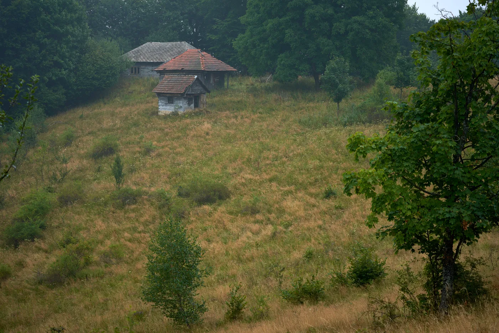
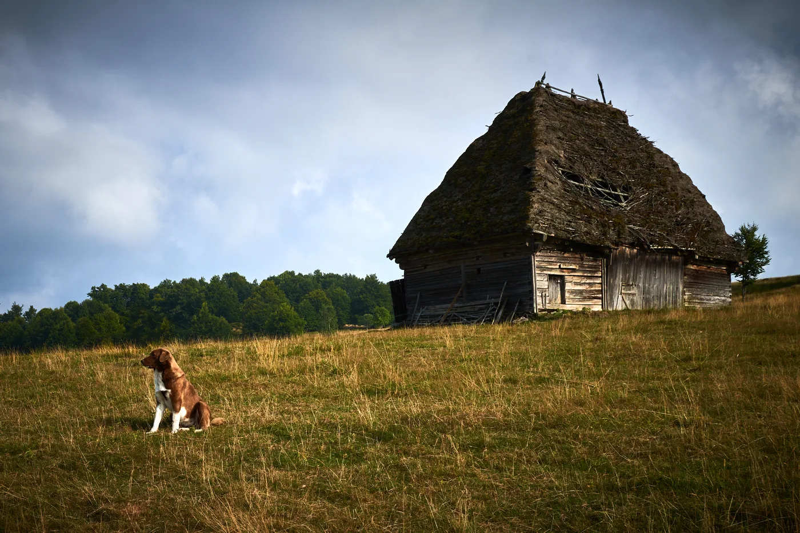
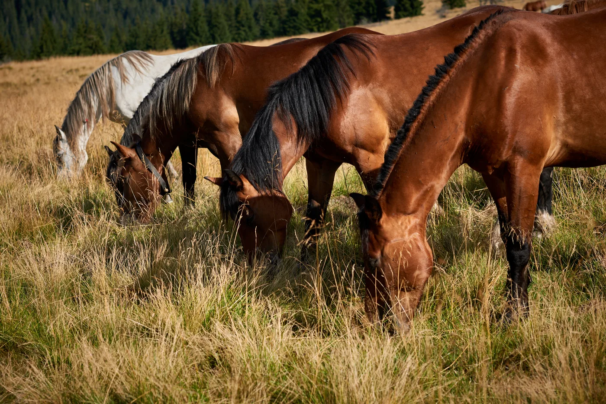
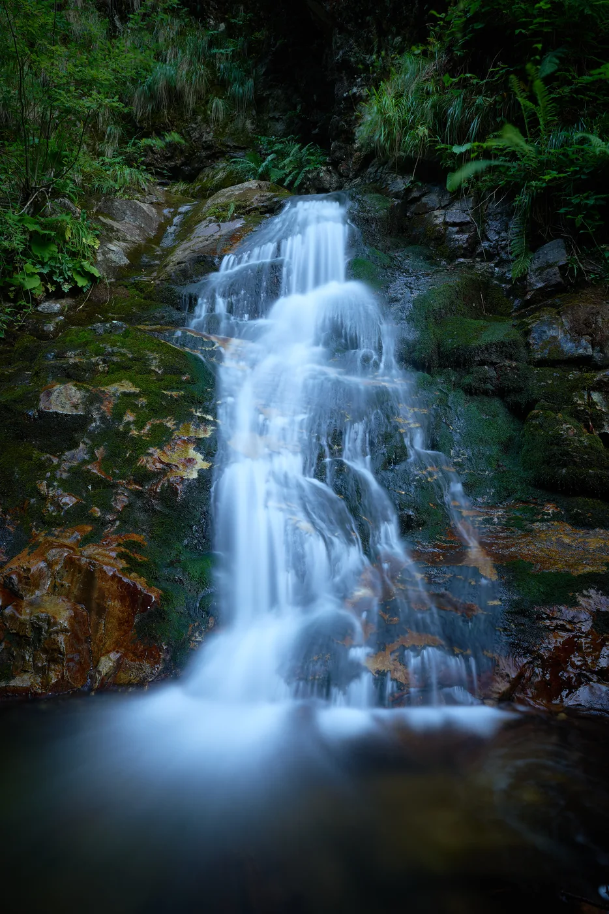
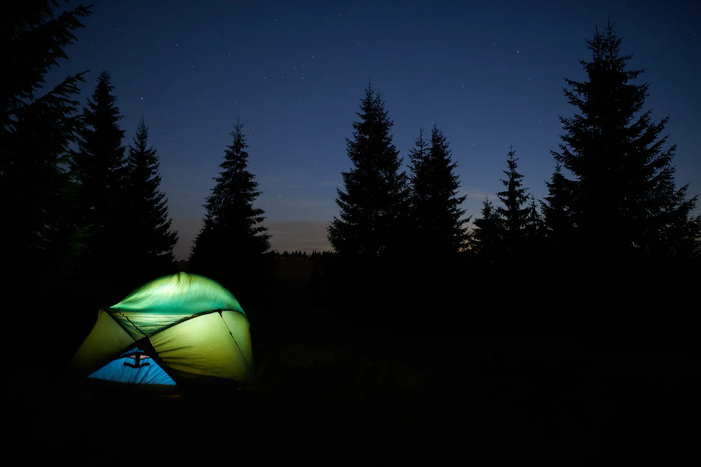
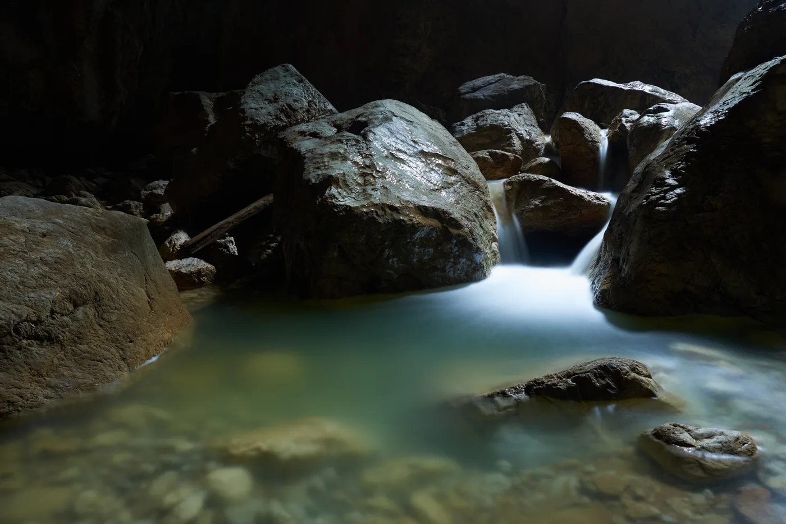

Our first trip to Romania started in Ciucea, a small village in the valley, and from there we slowly climbed toward the ridge of the Apuseni Mountains. Over the next week we walked about 80 kilometers south across Vlădeasa and the Bihor range, all the way to the caves of Cetățile Ponorului.

## Bears, deer, and empty pastures
The first shock came barely a few hours in: a bear's paw print, pressed clean into the mud of the trail. We told each other that bears are shy, like all the animals here. A few minutes later we walked past a group of deer just a few meters away, and they didn't even bother to move. We really hoped the bears would be shyer than that.

The hills around Ciucea felt abandoned. The meadows were overgrown and the huts stood empty, because most people here have traded shepherding for work in the big factories of Cluj. But the farther we went from the city, the more alive the mountains got, and soon we were meeting shepherds and their flocks almost every day.

## Shepherd dogs
With the shepherds came their dogs, and those dogs are trained to protect the herd at any price. They were the only animals on this trip that weren't shy at all. One afternoon I stopped to photograph an old hut, and before I knew it, a pack of them had surrounded me, closing the circle a little tighter with every step. I was saved by the other half of our two-person team, who came charging in, shouting at the dogs and swinging her walking stick around her head until they backed off.

## The most expensive bread in Romania
Food was the one thing we kept running short of. At Cantonul Sebișel we bought fresh cheese straight from the shepherds, which was wonderful, except that we had nothing left to eat it with. Near Stâna de Vale I climbed down to the village to buy supplies, only to find there was no shop, just a hotel. I walked out with a single loaf of bread that cost me about ten euros. It was probably the most expensive bread I've ever bought, but at least the cheese finally had company. I also filled up all our bottles, because it had been a dry summer and water on the ridge was hard to find.

## A night climb from Cascada Bohodei
We reached the hill above Cascada Bohodei in the late afternoon, and I didn't want to leave without seeing the waterfall. On the map it was a short trip. But it's not the distance that matters, it's the contour lines: the trail dropped from about 1,500 meters to 900, and it was brutally steep. By the time I reached the bottom of the valley, it was evening. There was still just enough light to photograph the waterfall. Then I started wondering how I would get back up.

The marked trail ended on bare rock. There was a small cave, so I tried that, but after five meters it went nowhere. So the only way was up. I climbed, and it wasn't the last climb of that evening. Darkness fell, and all I had was one very bad headlamp that lit about a meter in front of me. I had no idea where I was or where I was walking, which was horrible, and maybe also a blessing, because I couldn't see the drops around me either. I made it back to the tent around midnight, happier than ever just to be alive. Lessons were learned that night.

## A race with the buffaloes
The next morning I briefly thought about going back down to the waterfall in daylight. After the night before, I dropped that idea very quickly, and we moved on. Near Bohodei mountain we met a herd of Carpathian buffaloes, an ancient breed of water buffalo that has lived in Transylvania for centuries. They were heading the same way we were, toward the only spring around. It turned into a race, and we won. We filled our bottles with the precious water, and five minutes later the buffaloes arrived and turned the spring into a mud bath.

From there we continued to Cetatea Rădesei, a cave with a river running straight through it. After the dry summer, the river was just a small creek, so we could walk through the whole cave from one end to the other. When we came out, a few friendly locals offered us a ride in their van and took us all the way to Glăvoi, a small camp where we spent the night.

## Cetățile Ponorului at dawn
Early the next morning we left the tent at the camp and walked to Cetățile Ponorului, the "Citadels of Ponor": a karst system of huge cave entrances and sinkholes, with a river disappearing into the mountain. We went all the way through and down into the cave with the river. Deep inside, a single small window in the rock let in a thin beam of daylight, just enough to light up a waterfall in the dark. That photo is still one of my favorites from the whole trip.

We had the place to ourselves. Only on the way back did we meet the first other visitors, just arriving as we were leaving.

## Home before the storm
A few hitchhikes later we were in Oradea, waiting for the night train to Budapest. That night a huge storm broke over the region, and we watched it from the safety of the station, very glad not to be up on a ridge in a tent.

## Apuseni Mountains photo gallery

    <article class="article col col-12 col-t-12">
    
    </article>

