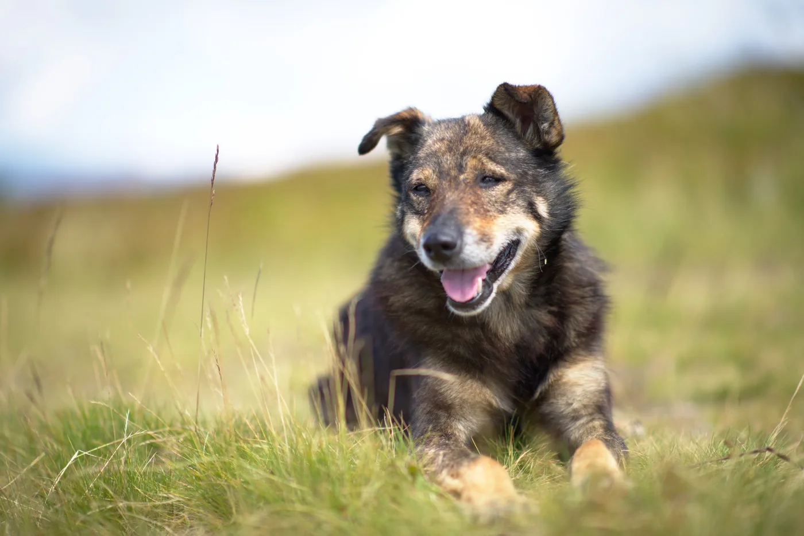
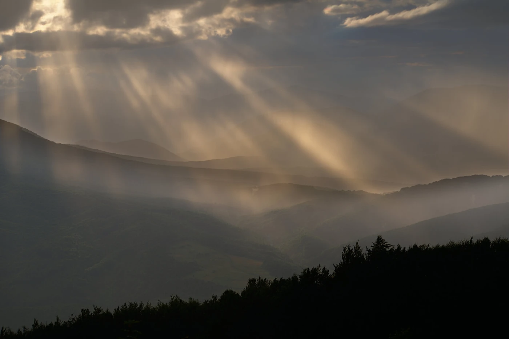
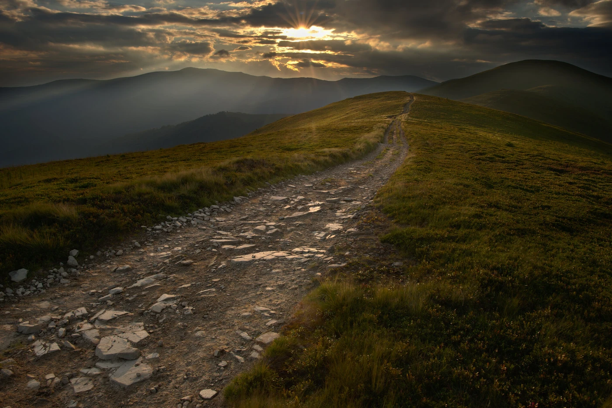
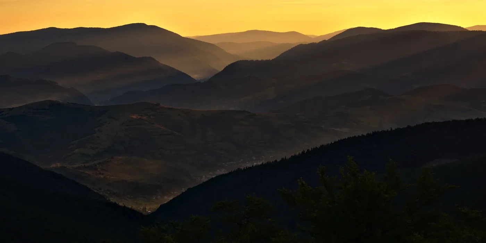
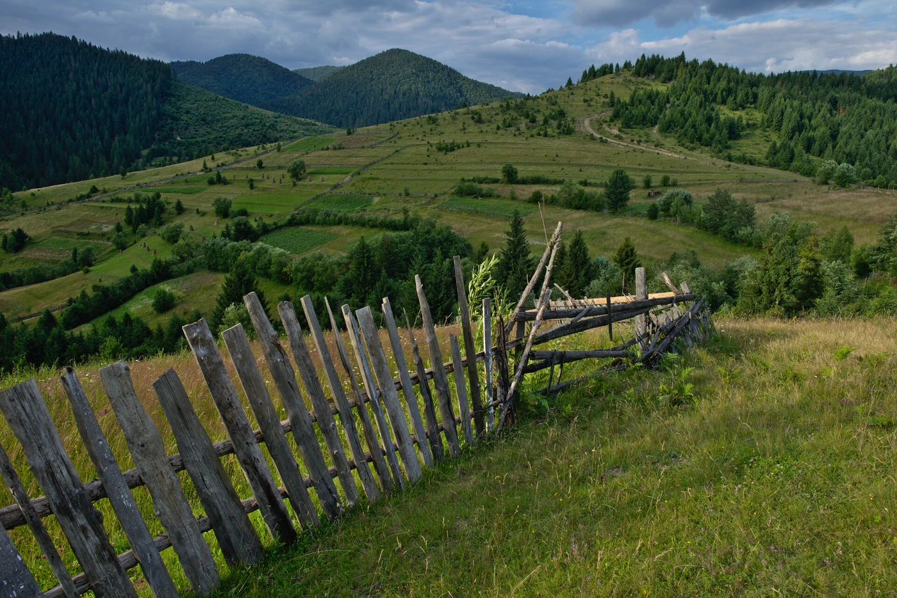
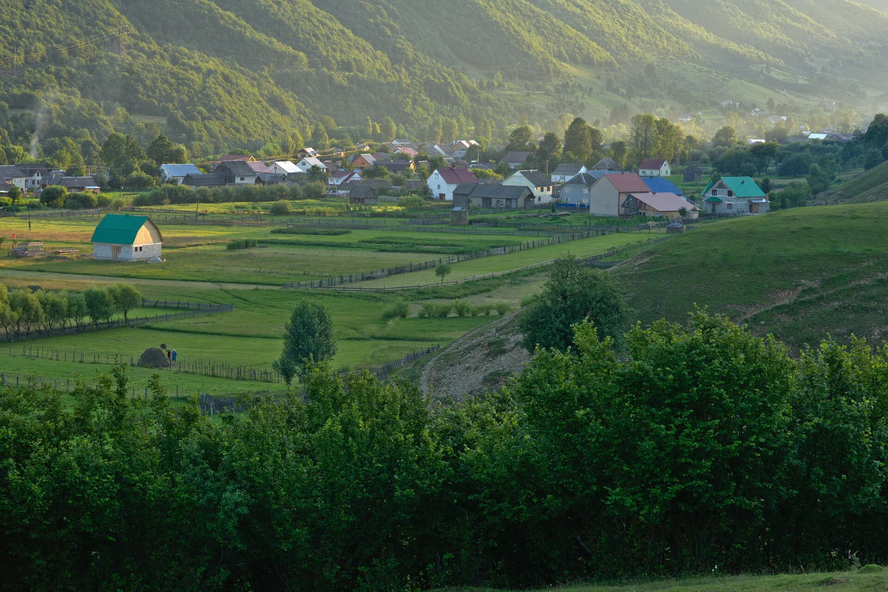

The trip started the way trips to Ukraine usually did back then: slowly. The drive across Slovakia was uneventful, and the Slovak-Ukrainian border took four and a half hours. In Mukachevo we negotiated a ride in a marshrutka, one of those minibuses built for about twenty people that somehow carries thirty, plus everyone's backpacks. By the time it let us out in Volovets, we were just glad to be walking. We didn't know yet that someone was about to join us.

## Lišák
He showed up the moment we got off the bus: a scruffy street dog with no collar and no obvious owner, who simply fell in step beside us and refused to leave. We named him Lišák, Czech for "fox," and within a day it was clear he wasn't following us so much as leading. He walked ahead on the trail, waited for us at every junction, and picked the way through the meadows and forest up toward Tsytska. He also appointed himself our bodyguard, standing between us and anything that came too close, day or night. We had come to hike the Carpathians on our own. It turned out we had a guide.

That first night we pitched the tent just below the summit, squeezed in between two rain showers.

## Summer, in theory
It was the beginning of July, and the weather hadn't been told. Rain came and went for most of the week, the wind on the ridge never really stopped, and the cold got into everything. We wore every layer we had and still wished we had packed more. My girlfriend hadn't brought a scarf, so she hiked the ridge with a kitchen towel wrapped around her neck.

The alarm went off at 4:20 the next morning, mist filled the valleys below us, and we ate breakfast on a summit under a wooden cross. The Borzhava ridge is one long, bald *polonina*, a treeless mountain meadow, and early July is blueberry season. Whole families were out on the slopes with combs and buckets, sometimes with a truck waiting on the dirt road to haul it all down. The highest point of our route was Velykyi Verkh, at 1,598 meters.

## Ten minutes of sunrise
Near Kuk, at the eastern end of the ridge, I woke up before sunrise, looked out of the tent, and almost went back to sleep. The whole sky was one flat lid of cloud. Then I noticed a thin gap low on the eastern horizon, barely a slit. I grabbed my gear and got ready, not really expecting anything.

When the entire sky is closed and the sun has only one narrow slot to shine through, the light doesn't spread out. It concentrates. The sun came up into that gap and set the layered hills below on fire, ridge after ridge glowing gold through the haze. I had less than ten minutes to take it all in. Then the gap closed, the gray came back, and it was gone for good. That's the photo at the top of this page, and it's still one of the most beautiful I've ever taken.

## Down to Mizhhiria
From Kuk the trail turned into a muddy slog along the ridge, past a small cheese dairy, and then dropped into a long, demanding descent to Mizhhiria. After days of nothing but meadows and wind, the town felt like a different country: a river, a church, a star on the main square, chickens in the street, crosses everywhere. We went straight to the shop, mostly to buy sausages for Lišák. He had earned them.

## Old gardens in the morning mist
The next morning was the one I'd been hoping for since the trip began. We had pitched the tent on a hillside above Mizhhiria, and when I crawled out at sunrise, mist was lying in every hollow of the small hills around the town. Old gardens and orchards, weathered wooden fences, haystacks, and horses grazing in the low backlight, all of it soft and half-dissolved in the fog. It was so quiet you could hear the horses chewing. Of everything we saw away from the ridge, this is what I remember most.

Then the weather swung the other way for a single day. We climbed meadows in blazing heat along a path lined with wayside crosses, went looking for a spring and found porcini mushrooms instead, and slid down a track churned into deep mud.

## Synevyr
Synevyr was a village of contrasts: dirt streets with cows wandering down them, right next to luxurious gates and brand-new houses, and a surprising number of Czech cars. We sat under a bridge for a while, waded through a street that had turned into a small Venetian canal, and spent the evening looking for somewhere to sleep, finally pitching the tent by the cemetery to the sound of crickets.

## Saying goodbye to Lišák
The hike ended in Kolochava, the village of Nikola Šuhaj, the outlaw every Czech reader knows from Ivan Olbracht's novel, and we went looking for his grave. Saying goodbye to Lišák turned out to be the hardest part of the trip. We said goodbye, and he found us again. We said goodbye again, and he found us again. Then once more.

In the end, we met a group of hikers setting off in the opposite direction, back toward the mountains we had just crossed, and Lišák went with them. We like to think they walked him home, if he ever had one.

The way back was its own small adventure: a broken car on a broken road, a bus to Khust with a storm rolling in, a luggage search at the border, and a night of sleeping on the train. We came for the mountains. What we remember first is the dog.

## Ukrainian Carpathians photo gallery

    <article class="article col col-12 col-t-12">
    
    </article>

