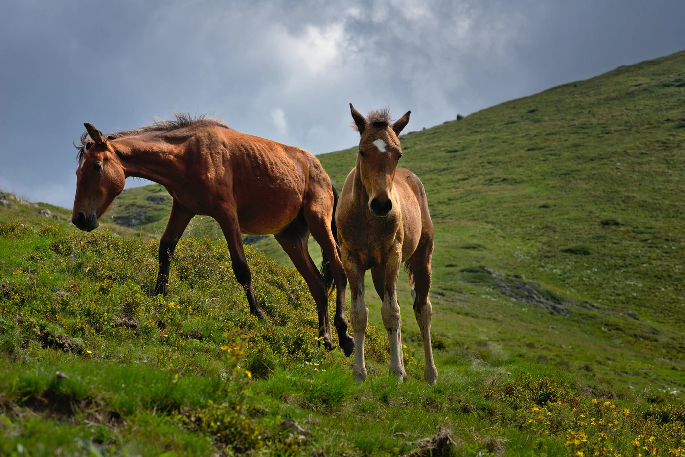
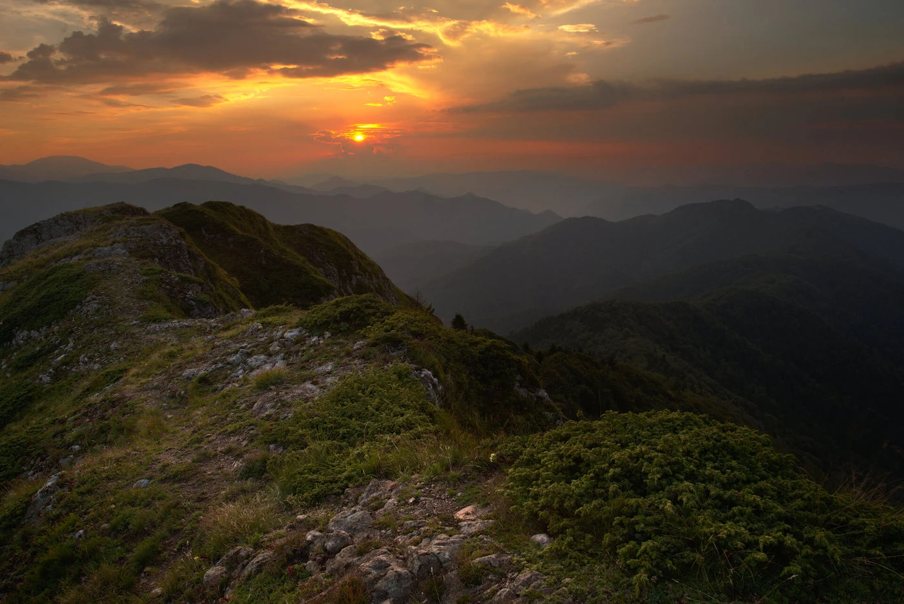
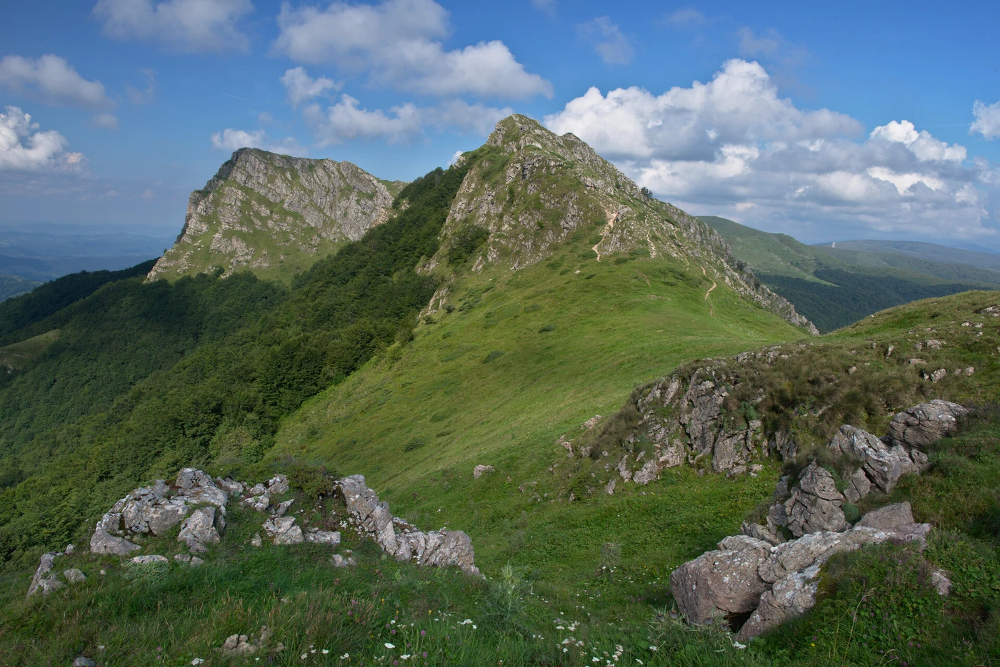
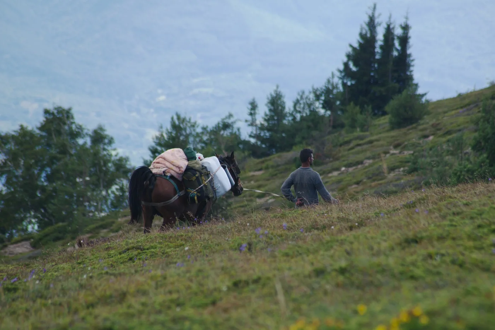
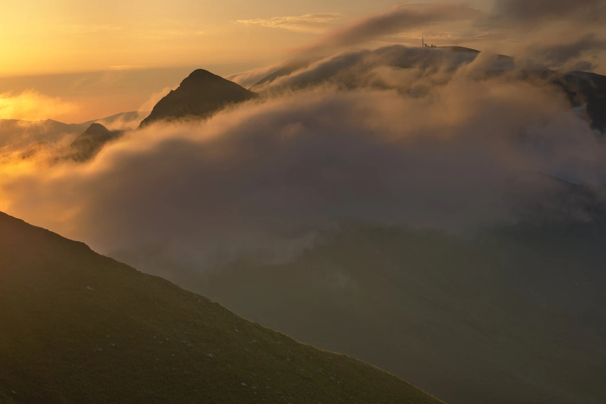
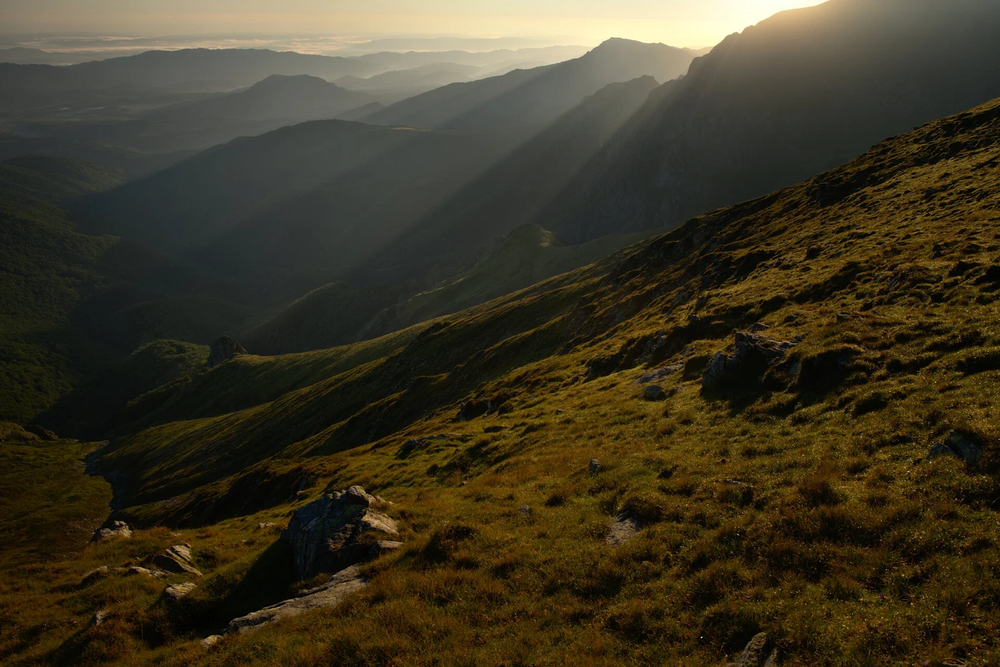
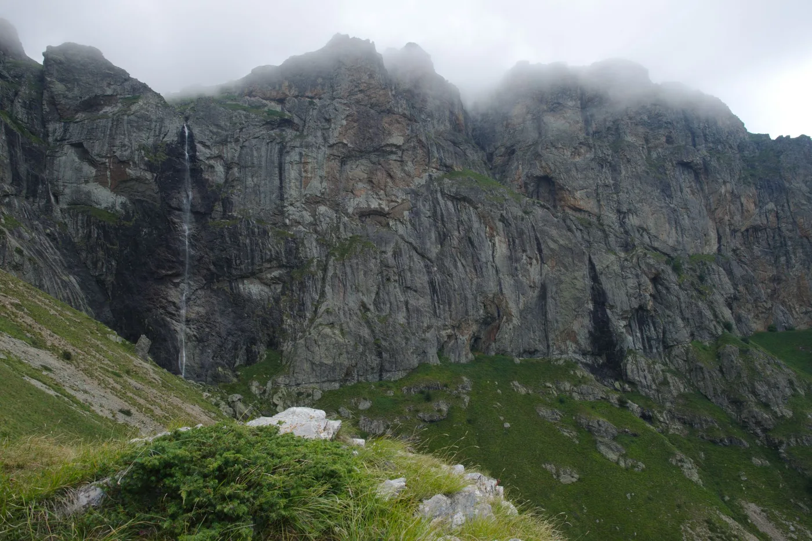
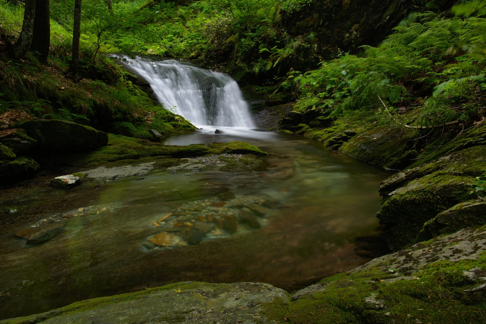

We reached the ridge near the Zlatitsa Pass already worn out from two days of hard travel, ate an early dinner, and couldn't have been happier. The plan was simple: follow the main ridge of Stara Planina east for a week, all the way to Botev Peak, and then walk down to Karlovo. In the end, it came to about 116 kilometers and almost 5,000 meters of climbing.

## Horses everywhere
The first full day on the ridge was all about horses: whole herds of Hucul horses grazing the open slopes, with mares and foals wandering right across the trail. The grass ran out into rocks, we climbed our first two-thousand-meter summit, and somewhere along the way we crossed into the Central Balkan National Park.

Water was the real problem up there. Springs on the ridge are few and far between, and that evening turned into a long march to the next one. We pitched the tent in the dark by a small wet meadow, too tired to care what it looked like.

## Vezhen and the Echo hut
The next morning made up for it with a spring so generous we could finally drink as much as we wanted. The ridge rolled on in a chain of hills and saddles, past a herder driving his horses along the crest, and then over a traverse that was beautiful and sharp in equal measure. We spent the night right under Vezhen.

Vezhen, at 2,198 meters, looks terrifying from below and turns out to be a pleasant climb. We stopped at a spring on the way up, took photos, and then faced the long descent on the other side. We reached the Echo hut in the evening, and from Kavladan just above it, the whole range dissolved in layers of orange haze.

## Kozya Stena: rocks, saffron, and soup
The heat started early the next day. This was the most demanding stretch of the whole ridge, a traverse in and out of the rock walls of the Kozya Stena reserve, and also one of the most beautiful. Saffron was in bloom, giant thistles lined the path, and every turn opened another view down the cliffs.

The Kozya Stena hut was a small miracle: excellent soup, a fresh supply of chocolate, and the warmest welcome of the whole trip. The people running it were so kind and friendly that we ended up chatting with them far longer than we'd planned. A little farther on, the ridge crosses the Beklemeto Pass, where the road drives straight through the Arch of Freedom, a huge monument to Bulgaria's liberation in 1878.

## Through the old forest
We packed fast the next morning and kept a brisk pace all day: to the Orlovo Gnezdo (Eagle's Nest) hut, where there was nobody at all, then on to the Dermenka hut for lunch. After that the trail dropped off the open ridge into the forest of the Steneto reserve, and the whole mood changed. It was damp and quiet, with pools of standing water and old trees hung with lichen, and there was a mushroom under every one of them. We met blueberry pickers leading horses loaded with their harvest.

## Clouds below Botev
In the morning I photographed Botev, the highest peak of the range, floating in a sea of clouds. Then came a hard climb back up above 2,000 meters and a view that made every step worth it: cloud filling the valleys on both sides of the ridge, with only the peaks sticking out. Instead of pushing on along the ridge, we turned back to the saddle and chose a different way down, a blue-green trail full of streams and waterfalls.

On the way we fell in with a friendly couple of hikers and walked together to the Vasil Levski hut. We spent a lovely evening talking, I went off to photograph the waterfalls nearby, and we treated ourselves to a night inside and a hot shower, at twenty-four leva well worth it.

## Sunrise on Botev
My alarm went off at 3 a.m., and I set out alone in the dark toward Botev. Halfway up, my headlamp picked out a flock of sheep and the shepherd dogs guarding it, right across the trail. Nobody argues with Balkan sheepdogs at four in the morning, so I made a wide detour across the slope instead.

The sun caught me still below the summit of Botev, at 2,376 meters the highest peak of the range, but I didn't mind. I stopped on the slope and watched the light pour across the ridges, sharp beams cutting down into the valleys that were still deep in shadow.

## From Hell to Paradise
The way down from Botev runs through the Dzhendema reserve, whose name comes from the Turkish word for *hell*: steep slopes, deep gullies, and wild streams. At the bottom waits the Ray hut, *Paradise*. I can't think of a better-named descent. I followed the waterfalls down to the hut and then on to Raysko Praskalo, *Heaven's Waterfall*, a thin white thread falling more than a hundred meters down a misty rock wall. It's the highest waterfall in the Balkans.

## The Stara Reka valley
The last stretch of the hike was also the longest and, for me, the most beautiful: the trail down the Stara Reka valley toward Karlovo, a narrow corridor following the river all the way, with white water rushing past at every step. It went on and on, and by the time it ended, it was dark. We pitched the tent one last time just above Karlovo, with the lights of the town below and the whole ridge we had walked somewhere behind us in the dark. A week earlier, Botev had been nothing more than a dot at the far end of the map.

## Central Balkan photo gallery

    <article class="article col col-12 col-t-12">
    
    </article>

