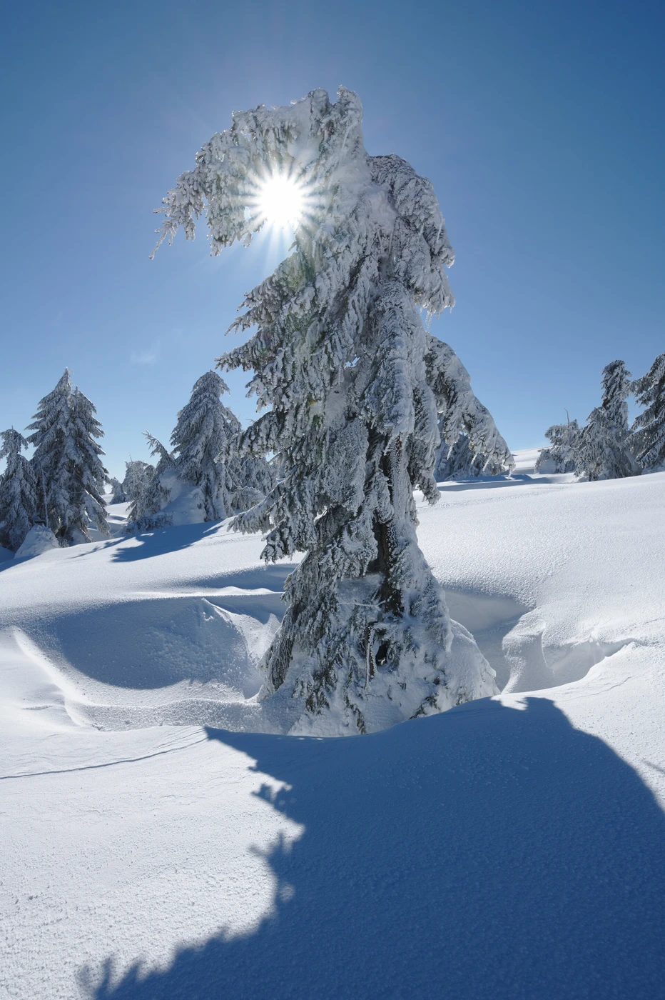
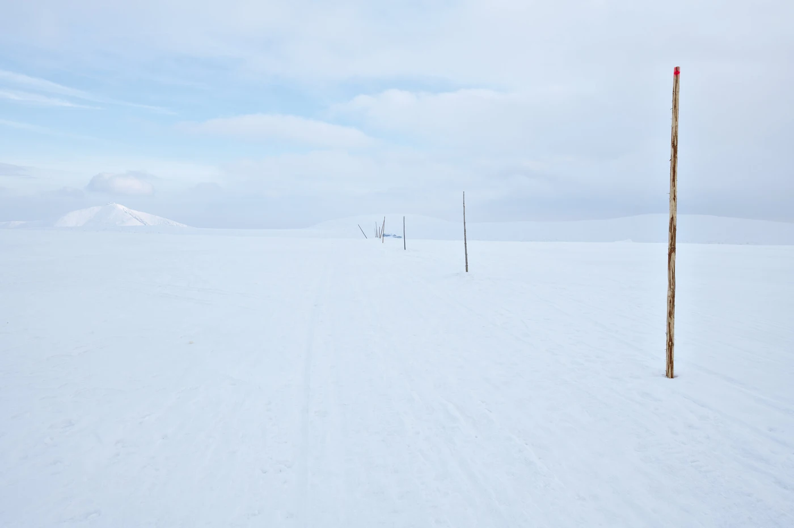
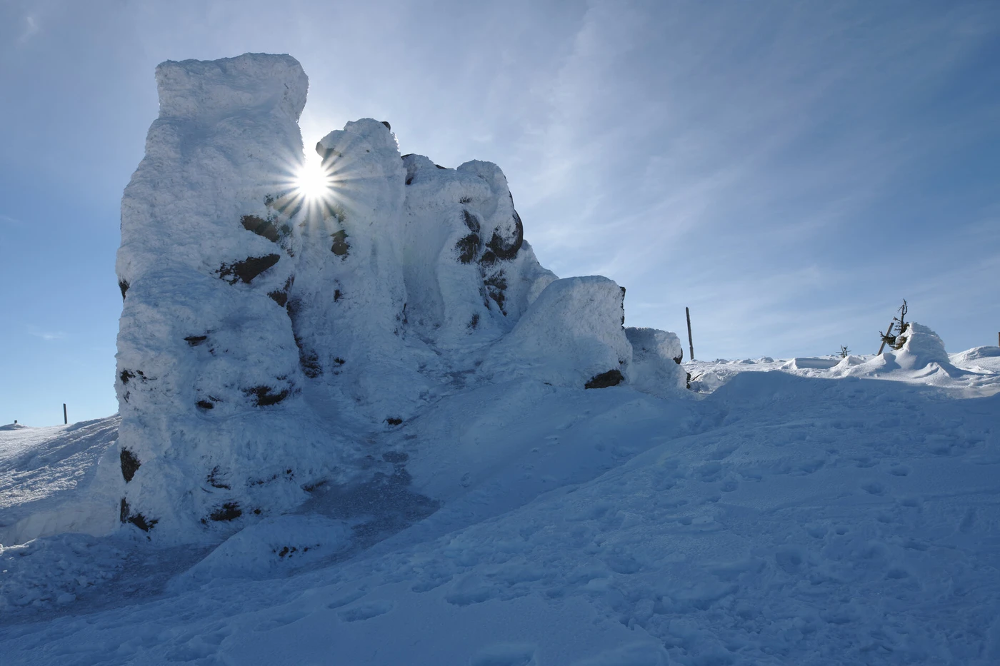
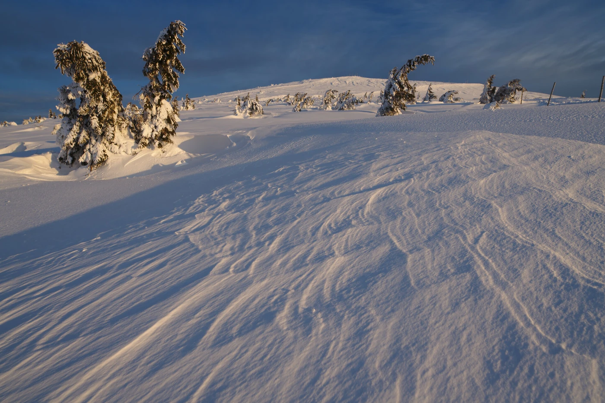

For five days in February, Horská chata Berghof was our base camp in the snow, and every morning we set off in a different direction.

The Krkonoše Mountains (Giant Mountains in English, Riesengebirge in German, Karkonosze in Polish) aren't high by world standards. Their highest peak, Sněžka, only just clears 1,600 meters. But they are the highest mountains in the Czech Republic, Krkonoše National Park is the oldest national park in the country, and in winter, the bare plateaus along the Czech-Polish border look more like the Arctic than Central Europe.

## Liščí hora and the Krkonoše Highway
The first day we strapped on cross-country skis for a loop to warm up. We skied up to Liščí hora, where I went up the lookout tower for the view, then continued past Liščí bouda to Lesní bouda for lunch. From there we followed the Krkonošská magistrála, the long trail that runs along the mountains, to Přední Rennerovky, and stayed there for a while just soaking up the sun. The way back to the hut was the fun part: a shortcut straight down through the snow, more sliding than skiing.

After that, we left the skis at the hut. The snow was packed so hard that walking was easier, and it got us everywhere we wanted to go.

## Sněžka in winter
The next day belonged to Sněžka. We took a shortcut across Úpské rašeliniště, the subarctic peat bog on the plateau below the summit. In winter it's one endless white field, with only a line of wooden poles to show where the trail goes. Then came the climb itself, up a path frozen into one long sheet of ice and busy with people who had all had the same idea. The crowds on top were forgotten as soon as we turned to the view: the whole range laid out in white, Bohemia on one side and Poland on the other.

## Wind on the Polish ridge
The weather was beautiful the following day, and the trails were almost empty. Once we crossed onto the Polish side, though, the wind hit us hard, and the path along the ridge was glazed with ice. Below us lay Wielki Staw, a glacial lake frozen solid and buried under snow. We went on past Słonecznik, the rock formation sticking up out of the ridge, and from there took a steep, icy, and honestly dangerous path down toward Špindlerova bouda. The way back felt twice as long, with the wind in our faces the whole time, and by the time we reached the hut, we had very little left.

## Klínové boudy
On the last day, we walked to Klínové boudy, a scatter of old wooden chalets high on a ridge, one of those places in Krkonoše that still feels the way the mountains must have felt a hundred years ago. In the late afternoon, the low winter sun turned the snow gold, and every frozen spruce threw a long blue shadow across the drifts.

Five days, one hut, and a different corner of the mountains every day. Krkonoše may be small, but in winter they never felt that way.

## Krkonoše photo gallery

    <article class="article col col-12 col-t-12">
    
    </article>

