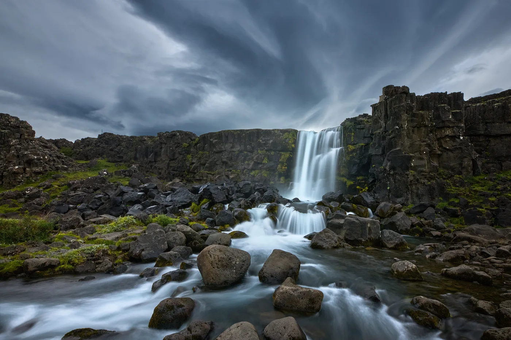
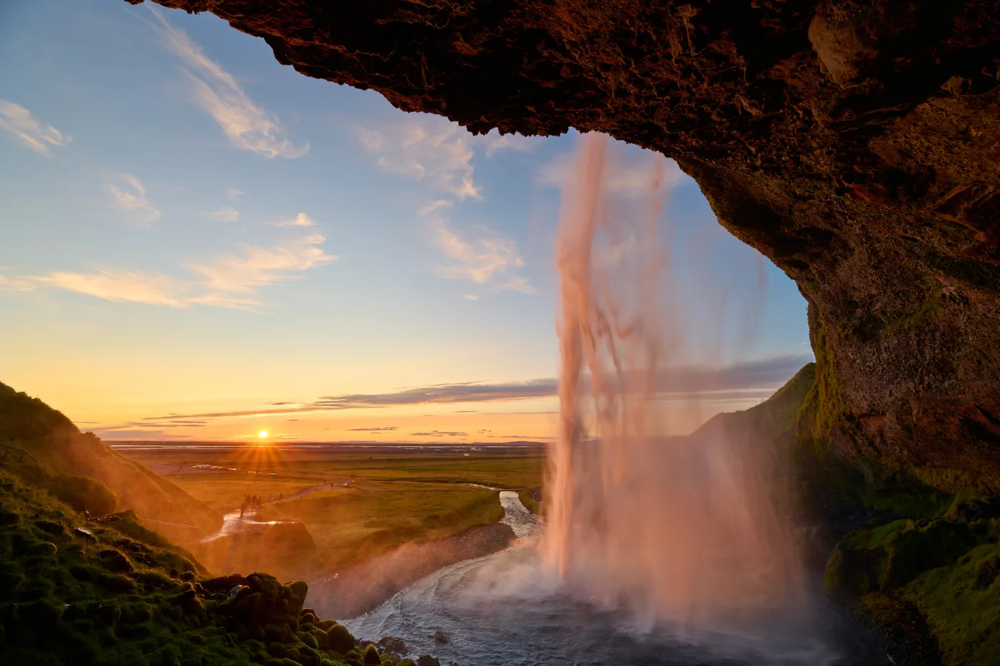
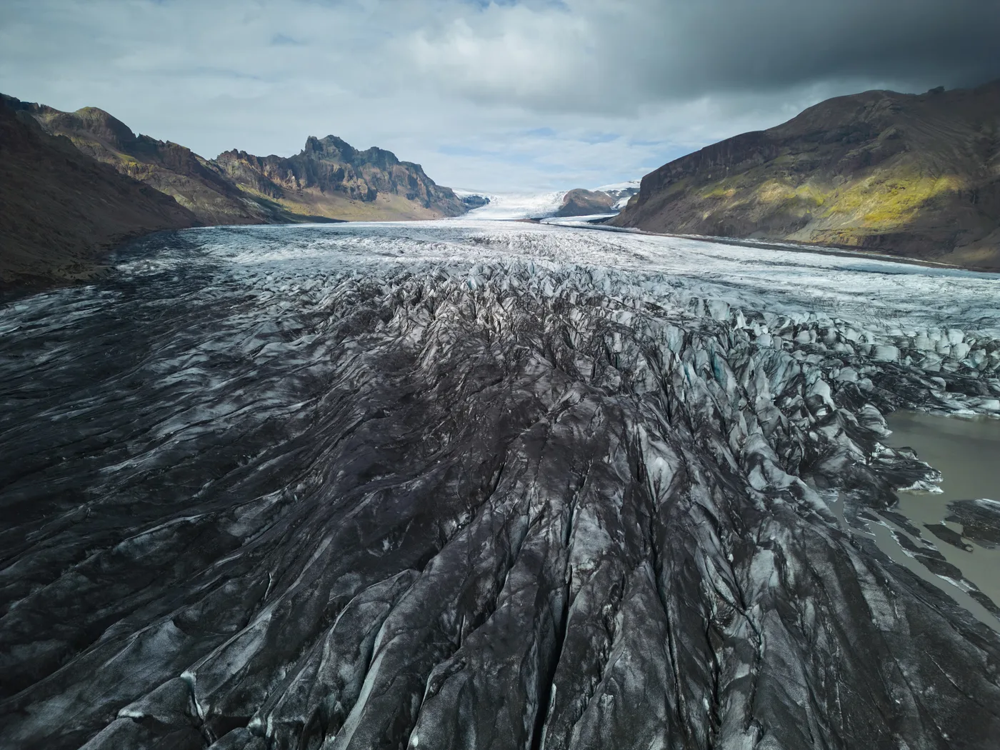
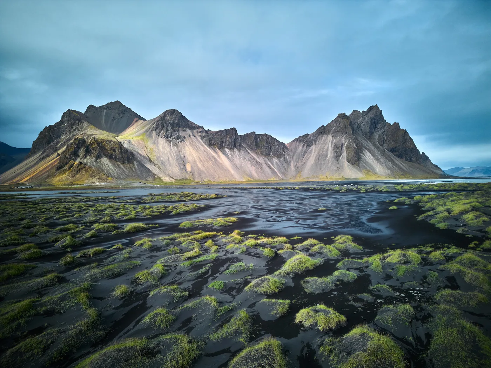
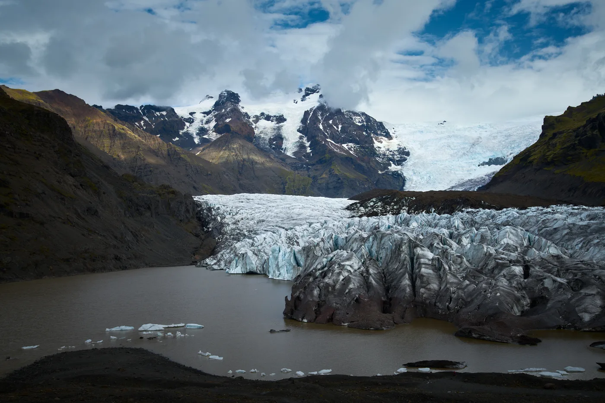
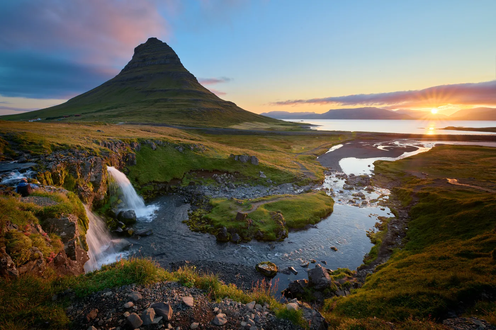
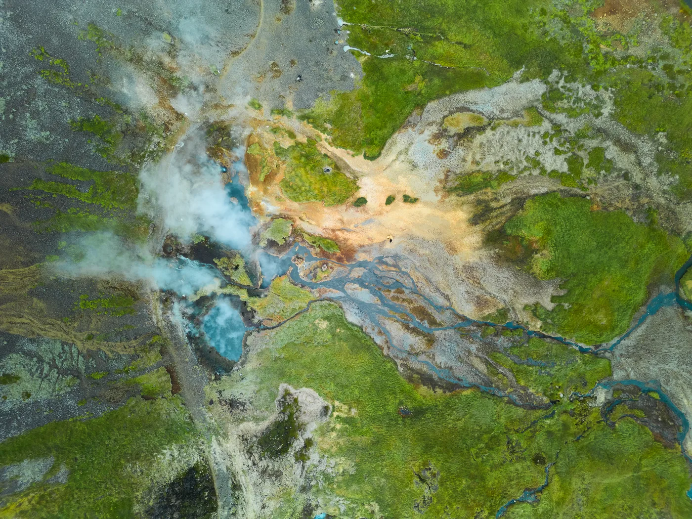

I had the whole thing planned before I even landed: the full Golden Circle, a few nights deep in the highlands, then a long push west. By the end of day one, none of it was going to happen. Low cloud rolled in over Þingvellir and just stayed, and somewhere in that gray I stopped checking the plan and started checking the sky instead. That turned out to be the better strategy for the whole trip.

## Þingvellir, Geysir, and a plan already unraveling
Þingvellir was still worth the detour: standing in a rift valley where two continents are quietly pulling apart, a few centimeters farther every year, has a way of making your own schedule feel very small. At Geysir I waited out three eruptions of Strokkur just to get the timing right, that strange half-second where the water domes up before it lets go, and by the time Gullfoss was thundering below me, I already knew the highland huts I'd booked were a lost cause. Everyone else had seen the same forecast and moved faster.

## An accidental waterfall
So I turned the car around with no real plan and ended up at Seljalandsfoss instead. I walked in behind the falling water right as the sun broke out for sunset, the whole curtain lit gold, spray hanging in the air an arm's length from my face. I hadn't meant to be there. I'm glad I was.

Farther down the coast the color drained out of everything: gray sky, black sand, the basalt columns at Reynisfjara standing in the surf like something built rather than grown. Then a handful of puffins showed up on the cliffs above, absurdly bright against all that gray, and I lost an hour just watching them.

## The window, and the turn east
Somewhere around Skaftafell, the trip reminded me it wasn't a movie. I came back from a walk to a smashed car window and spent the evening on the phone with a rental company instead of behind a camera, waiting until 1 a.m. for a replacement to show up. Not the part of Iceland I came to photograph, but it happened, so it's part of the story.

I kept pushing east anyway, chasing a break in the weather the forecast swore was coming. It never showed. Near the easternmost point of the route, I finally believed the sky over the plan and turned the car back the way I'd come.

## Vestrahorn's last-minute light
That U-turn was the best decision I made on the whole trip. On the way back I stopped at Vestrahorn, that wall of jagged black peaks standing straight out of the sand near Höfn, and got there to flat gray nothing. I gave it twenty minutes, then thirty, ready to call it. Then the sky just opened over Stokksnes. I stayed another hour, alone with one of the most photographed mountains in Iceland, watching it do exactly what it's famous for.

## The night on the mountain
A side trip into the highlands at Þakgil got me a glacier view that alone justified the whole detour, but the way back down split us onto two different paths, and a phone died at exactly the wrong moment. What should have been an hour's walk turned into hours of not knowing where everyone was, then a headlamp climb back up the mountain in the dark to close the gap myself. We were back at camp well past midnight. It's a far better story now than it was while it was happening.

## Two sunrises at Kirkjufell
By the time the road finally bent west toward Snæfellsnes, I felt like the weather owed me one. My first evening at Kirkjufell, I stood shoulder to shoulder with what looked like every photographer in Iceland, and the sunset was fine. Just fine. So I got up before sunrise the next morning and drove back in the dark, half-expecting the same crowd. Instead, just me and two other photographers, and a sky that did precisely what a photographer hopes for and rarely gets: mountain, waterfall, and fjord lined up in perfect light. That's the photo from the Kirkjufell waterfall viewpoint at the top of this page.

## A different planet, an hour from Reykjavík
The last stop was Reykjadalur, where the hike up the valley ends in a river warm enough to sit in, steam drifting off the surface in every direction. I put a drone up over the geothermal ground nearby almost as an afterthought, and the shot that came back looked nothing like Iceland: turquoise, ocher, and sulfur-yellow bleeding into each other, more like a satellite photo of somewhere uninhabitable than a hillside an hour from the capital.

None of this was the trip I planned. It was better.

## Iceland photo gallery

    <article class="article col col-12 col-t-12">
    
    </article>

