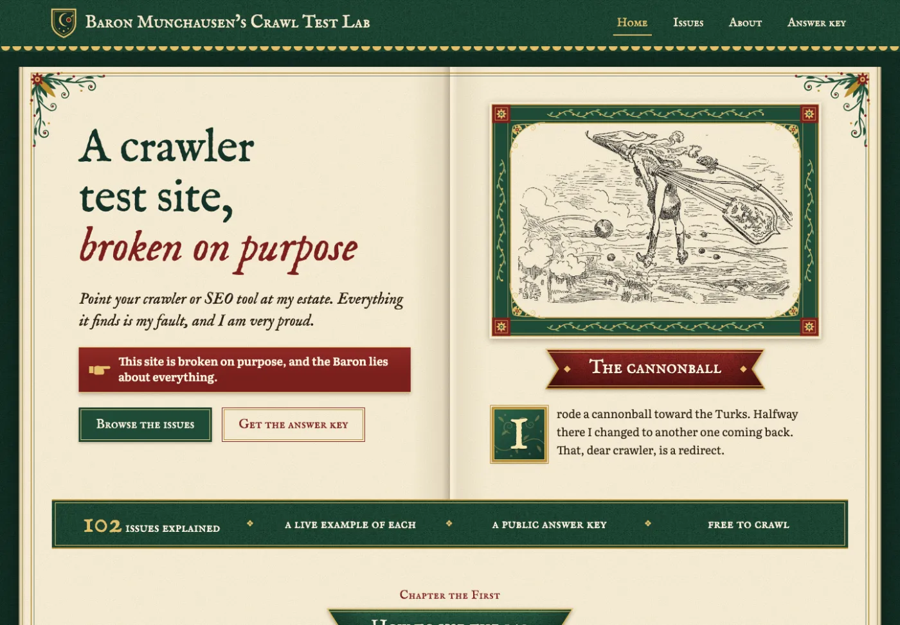
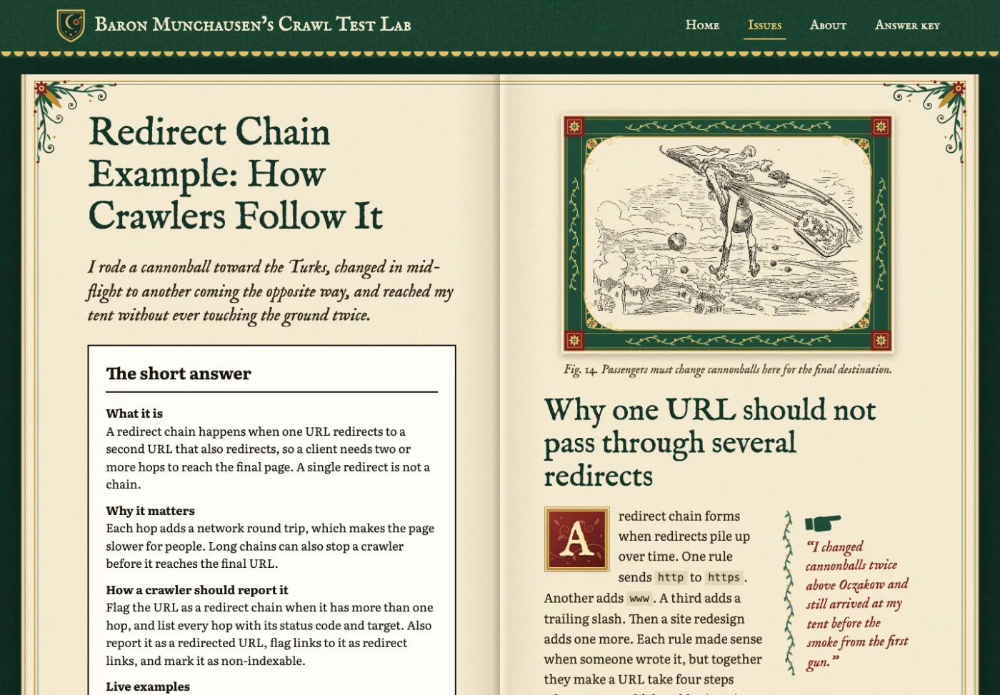
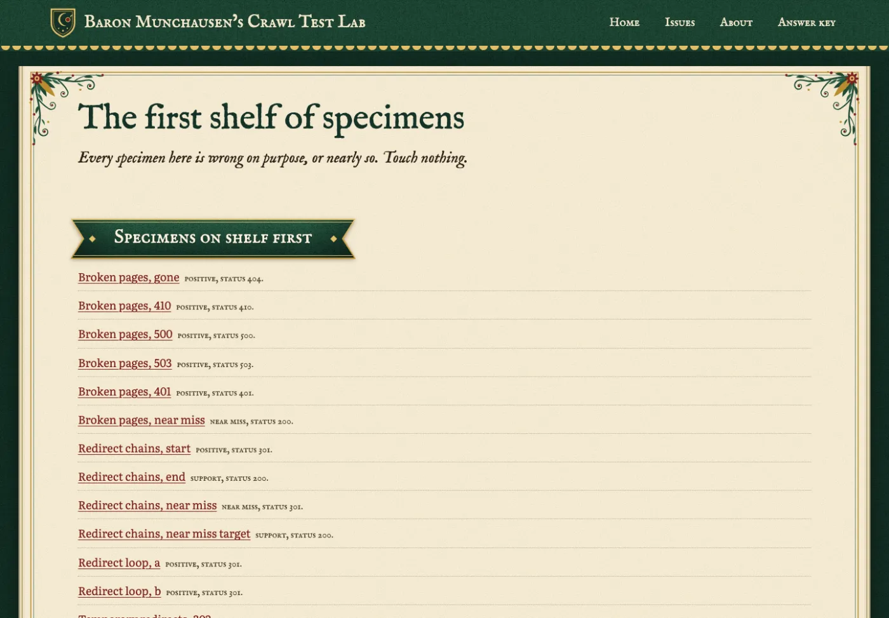

Every SEO crawler promises the same thing: point it at a website, and it will tell you what is wrong. The hard part is knowing whether that report is right. A real website gives you no ground truth. If the audit says nothing about redirect chains, you can't tell whether the site has none or whether the tool missed them. [Crawl Test Lab](https://crawltestlab.com/) solves this by flipping the problem around. It is a public website that is broken on purpose, and it tells you exactly how.

## What Crawl Test Lab is
Crawl Test Lab, also called *Baron Munchausen's Crawl Test Lab*, is a free [crawler test website](https://crawltestlab.com/) for SEO crawlers and technical audit tools. It plants known defects across a few hundred URLs, covering everything from 404 pages and redirect loops to conflicting canonicals, broken sitemaps, and missing alt text. It also publishes a machine-readable answer key at [/truth.json](https://crawltestlab.com/truth.json), which lists what a correct crawler should report for each URL.

The theme is the 18th-century liar Baron Munchausen. Every page opens with one of the Baron's tall tales, illustrated with Gustave Doré's public-domain engravings. A cannonball ride that changes direction mid-flight becomes the explanation of a redirect. The jokes are there, but the technical content underneath is dry and precise.

<a href="/img/other/crawltestlab/crawler-test-site-home-page.webp" data-lightbox="story"></a>

## Why a crawler test site is useful
Crawler test sites are not a new idea, but most of them are a loose collection of broken pages. You crawl them, look at the report, and judge by eye whether the results seem plausible. That works for a quick smoke test. It doesn't work when you want to measure a tool, compare two tools, or catch a regression after an update.

Crawl Test Lab adds the two things that make a real test possible:

* **An answer key.** For every URL, the site states the expected outcome. You don't have to guess what the crawler should have found.
* **Near misses.** Next to almost every defect stands a page that looks suspicious but is correct. A redirect chain sits next to a single clean redirect. A page with two H1 headings sits next to a page with one. A good crawler flags the first and stays silent on the second.

The near misses matter as much as the defects. It's easy to build a tool that flags everything. It's much harder to build one that flags the right things and nothing else. False positives waste time in a real audit, because someone has to check each one and dismiss it.

## What the lab covers
The site explains 102 issues, grouped into nine categories:

* **Status codes and redirects:** 404, 410, 500, 503, and 429 responses, [soft 404s](https://crawltestlab.com/issues/soft-404/), [redirect chains](https://crawltestlab.com/issues/redirect-chain/) and loops, 301 versus 302, meta refresh and JavaScript redirects, slow pages.
* **Titles and headings:** missing, short, long, and duplicate titles, missing or multiple H1s, empty H1s, missing and duplicate H2s.
* **Content and social:** thin and near-duplicate content, readability, Open Graph and Twitter Card tags, social image size.
* **Indexing and canonicals:** noindex and [noarchive](https://crawltestlab.com/issues/noarchive/) in meta tags and in the `X-Robots-Tag` header, missing, relative, broken, and conflicting [canonical tags](https://crawltestlab.com/issues/canonical-tag/), canonical chains, canonicals that point to redirects or noindex pages, cross-domain canonicals.
* **Crawl control and URLs:** [robots.txt errors](https://crawltestlab.com/issues/robots-txt/), URLs blocked by robots.txt, sitemap errors, `lastmod` problems, [orphan pages](https://crawltestlab.com/issues/orphan-pages/), crawl depth, [long URLs](https://crawltestlab.com/issues/long-url/), uppercase letters, underscores, spaces, and non-ASCII characters in URLs.
* **Links:** broken internal and external links, links to redirects, internal nofollow, empty and generic anchor text, uncrawlable links, missing `rel="noopener"`.
* **Images and assets:** broken images, missing alt text and dimensions, large and legacy-format images, uncompressed assets, missing cache headers, assets blocked by robots.txt.
* **Markup and headers:** invalid head tags, HTML validation, structured data errors, [hreflang](https://crawltestlab.com/issues/hreflang/), missing viewport, security headers, mixed content.
* **Added curiosities:** pages that treat bots differently, AI bot blocking, `llms.txt`, `unavailable_after`, and a few other edge cases.

Each issue has a clean explainer page in the list of [technical SEO issues](https://crawltestlab.com/issues/). It starts with a short answer (what the issue is, why it matters, and how a crawler should report it), then links to the live examples in the lab, and ends with a longer section on how to find and fix the problem on a real site. The explainers work as a small technical SEO reference even if you never run a crawler against them.

<a href="/img/other/crawltestlab/redirect-chain-issue-explainer.webp" data-lightbox="story"></a>

The broken pages live under `/lab/` and are arranged on four "shelves". Each shelf lists its specimens with the role and the expected status code, so you can also walk through them by hand.

<a href="/img/other/crawltestlab/lab-shelf-of-broken-test-pages.webp" data-lightbox="story"></a>

## The answer key
The answer key is a JSON file at [crawltestlab.com/truth.json](https://crawltestlab.com/truth.json). It is generated at build time from the same source as the pages, so it can't drift out of sync with them. The home page even announces it in an HTTP header:

```
$ curl -sI https://crawltestlab.com/ | grep -i ^link
link: </truth.json>; rel="describedby"; type="application/json"
```

The main part of the file is a `urls` array. Each entry describes one test URL:

```json
{
  "url": "https://crawltestlab.com/lab/broken-pages/410/",
  "path": "/lab/broken-pages/410/",
  "check": ["broken_pages"],
  "kind": "positive",
  "status": 410,
  "redirect_target": null,
  "canonical": null,
  "indexable": false,
  "in_sitemap": false,
  "explainer": "/issues/410-gone/",
  "linked_from": ["/lab/shelf-1/"]
}
```

The `kind` field says what role the page plays. `positive` means the page has the defect and should be flagged. `near_miss` means it looks suspect but is fine and should not be flagged. `support` marks helper pages, such as the final target of a redirect chain. At the time of writing, the key holds 294 URLs: 169 positives, 103 near misses, and 22 support pages.

Besides the URL list, the key contains:

* **`site_level`**: findings that belong to the whole site rather than one page, such as each broken line in `robots.txt`.
* **`clean_pages`**: the explainer pages, which should produce no findings at all.
* **`not_possible`** and **`partly_possible`**: issues that a test site can't produce on its own. Core Web Vitals field data needs real Chrome users, Search Console checks need a verified property, and log analysis needs an imported log file. The key lists these honestly instead of pretending to cover them.

Because the key is plain JSON, you can query it with `jq`. To list all near misses:

```
curl -s https://crawltestlab.com/truth.json | jq -r '.urls[] | select(.kind=="near_miss") | .path'
```

Or to see what a crawler should do with redirect chains:

```
curl -s https://crawltestlab.com/truth.json \
  | jq -r '.urls[] | select(.check | index("redirect_chains")) | "\(.path) \(.kind) \(.status) -> \(.redirect_target)"'
```

## A robots.txt with deliberate mistakes
The site's [robots.txt](https://crawltestlab.com/robots.txt) is a test case of its own. It contains a rule before any `User-agent` group, an unsupported `Noindex:` directive, an unknown `Foo: bar` field, a path without a leading slash, a line without a colon, and a relative sitemap URL. It also blocks a test section for GPTBot only, sets a crawl delay for an invented bot, and includes a comment from the Baron that a parser must simply ignore. A crawler that reports all of these and still follows the valid rules has a solid robots.txt parser.

## Three hosts
The lab runs on three hostnames:

* **crawltestlab.com**: the main site with the explainers and the lab.
* **www.crawltestlab.com**: a twin of the main host, for testing how a crawler handles host variants.
* **stress.crawltestlab.com**: a stress section with about 5,200 generated pages. It is not linked from the main site, so a normal crawl stays small. Start a separate crawl there if you want to see how a tool behaves at scale.

## How to use the crawler test website
1. Start a crawl at `https://crawltestlab.com/` with your crawler's default settings and let it follow every link.
2. Export the results: status codes, redirect targets, canonicals, indexability, and the list of issues per URL.
3. Download the [answer key](https://crawltestlab.com/truth.json).
4. For each `positive` entry, check that the crawler reported the issue named in `check`. Each one it misses is a false negative.
5. For each `near_miss` entry, check that the crawler did *not* report that issue. Each one it flags is a false positive.
6. Compare the site-level findings, mainly robots.txt and sitemaps, with the `site_level` section.

If your tool samples pages for slow checks like HTML validation or Core Web Vitals, raise the sample size above the number of URL templates. Otherwise, the deeper lab pages may fall out of the sample and look like misses.

The site runs on a free hosting plan, so it asks crawlers to keep to about ten requests per second. That is plenty for a few hundred URLs.

## Who it is for
* **SEO specialists** choosing between audit tools can crawl the same site with each tool and compare the results with the same ground truth, instead of comparing marketing pages.
* **Developers of crawlers and SEO tools** can run it as a regression test and catch checks that stop firing or start firing on near misses.
* **Anyone learning technical SEO** can read the explainers and then open the live example to see what a broken canonical or a soft 404 looks like in the source code and the HTTP headers.

## Conclusion
[Crawl Test Lab](https://crawltestlab.com/) is a small, well-thought-out idea: a website that is wrong on purpose and documents every mistake. The near misses and the public answer key turn "this report looks about right" into a number you can measure. If you build, buy, or rely on a website crawler, it's worth a test crawl to see how many of the Baron's lies your tool can catch.
