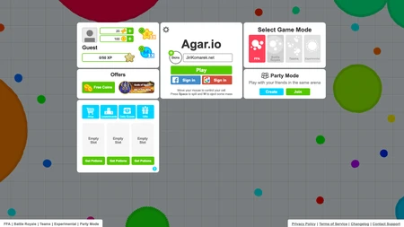
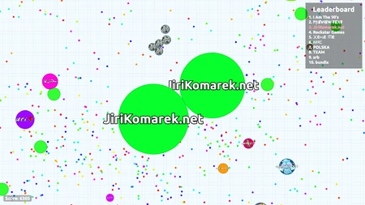
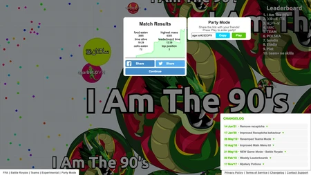
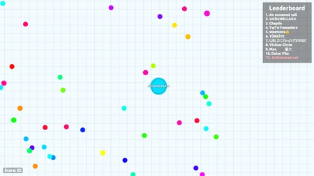
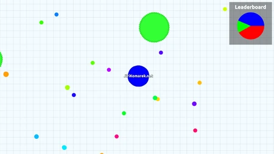
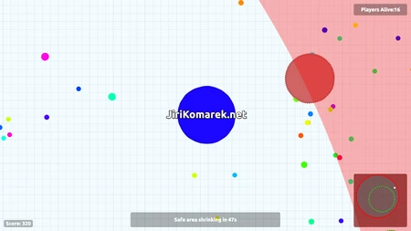
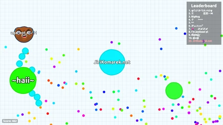
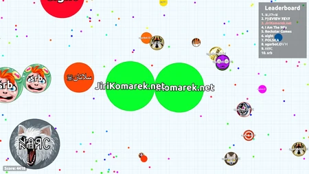
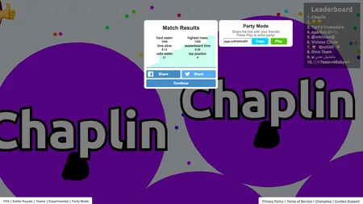

[Agar.io](https://agar.io/) is a multiplayer browser game created by Brazilian developer Matheus Valadares and released on April 28, 2015. It is published by Miniclip and is also available as a mobile app for iOS and Android. More than ten years later, the game is still online, and this guide explains how to play Agar.io, its controls, skins, and game modes.

## Game principle
The player controls a small cell using a mouse. The cell grows when it eats agar (small colored dots) or competitors' cells. In the upper-right corner, there are statistics with the top 10 players. The game's goal is to eat as much as possible and get to the highest position. As the cell grows, it moves slower. On the other hand, the visible area expands.

When the cell rides over a significantly smaller cell, it swallows the other cell and gains size. But if a bigger cell drives over a virus, it explodes into many smaller parts. This flock of cells gains higher speed (equivalent to their size) but can easily be swallowed by other cells.

<article class="article col col-12 col-t-12">
<ul class="image-gallery">

<li></li>
<li></li>
<li></li>

</ul>
</article>

## Game modes
### FFA
FFA is the *classic mode* where you play on your own against unknown people from the internet. The goal is to gain as much size as possible, get to the top of the score chart, and stay there as long as possible.

### Battle Royale
The Battle Royale is similar to FFA. The difference is that after a specific time limit (two minutes), the playground gets smaller, which means you have to get closer to your enemies. Everybody starts simultaneously (you are waiting at the beginning of the game for other players: the minimum is 20 players for a game), so nobody has any advantage.

The game dynamic is swifter, as there is a known end.

### Teams' game
There is a pie graph in the teams' mode instead of the top 10, which shows the ratio of the three teams (red, green, and blue). The strategy is also different: instead of individual survival, the good of the team is more important.

### Experimental
The Experimental mode was created after an unsuccessful introduction of game improvements. This branch works as beta testing of new functionality before rolling into the main game. On June 11, 2015, game devs introduced the mother cell — a big red circle in the middle of the playground. Later, the mother cell was split into smaller ones evenly distributed over the whole field. The mother cell shoots agar around — about 10% of all agar available on the playground. If a smaller cell drives into it, it is sucked inside and emitted in the form of agar.

The viruses also work differently: instead of duplicating after seven shots of mass, they fire in the opposite direction of feeding.

### Party
The classic and party modes have identical rules. The only difference is that the other players on the server in the party mode are only friends you invited.

<article class="article col col-12 col-t-12">
<ul class="image-gallery">

<li></li>
<li></li>
<li></li>

</ul>
</article>

## Starting the game
Every player needs to pick a nickname (or leave it blank), select the game mode (the default one is FFA), and start playing by clicking the Play button. They can also click on Settings and choose some advanced settings or click on the Spectate button to watch the best player. To leave spectate mode, press the Esc key.

## Agar.io controls
* **Mouse:** move your cell
* **Space:** split your cell
* **W:** eject mass
* **Mouse wheel:** zoom in and out
* **Esc:** leave spectate mode

The player controls the cell by mouse movement. If the player moves the pointer to the left, the cell moves in the same direction.

The zone where one can operate is a square battlefield. In the Battle Royale mode, the *safe area* shrinks into smaller circles.

### How to split in Agar.io
The cell splits into two parts by pressing the **Space button** (works only for cells of a certain size). It is handy in two situations: to gain speed if the cell is chased by a bigger player (smaller cells are faster than the bigger ones). More often, splitting is used for eating other cells. If the cell is double the size of a nearby competitor, the player can split by pressing Space in the direction of movement. The initial speed is very high, and if they don't miss (and their cell is sufficiently bigger), the other cell is eaten. These two parts will merge after some time. One can observe merging beforehand by the behavior of the cell's parts: if one piece slowly penetrates another, the merge is coming.

### Ejecting mass
The last button is the **W** key. The player fires small parts of their own mass into open space by pressing it. There are a few use cases:
* You can *feed* someone else, which is very useful in the Teams' game mode. It is often used when one cell is chased by another one from a different team: by feeding, you can grow your teammate and change the positions of predator and prey. The efficiency is only 80%, which means one player gets just 80% of the mass given away by the other one.
* In the FFA mode, it is used to duplicate viruses. A fed virus starts to grow, and at a specific moment (after it is fed 7 times), it reproduces. The newly created virus fires in the opposite direction of the last feeding. This technique is used for destroying much bigger competitors.
* It is also used as a form of communication (by shooting mass onto another cell, you can proclaim peace or ask for help to destroy another cell). Sometimes, symbiotic partnerships are created when a smaller cell helps the bigger one and gets protection as a reward.

### Zooming in and out
Zooming in and out is possible using the scroll wheel.

<article class="article col col-12 col-t-12">
<ul class="image-gallery">

<li></li>
<li></li>
<li></li>

</ul>
</article>

## Agar.io skins
Skins change the look of your cell. Click the **Skins** button next to the nickname field to open the skin shop. Most skins are bought with coins and are sorted into categories such as Premium and Veteran. You can also design your own cell in the *Create your own skin* editor. In the early days of the game, skins were unlocked by typing a special nickname, such as a country name; today, the Skins menu is the main way to get one.

## Tips and tricks
If you are small and want to drive between two big ones, don't be afraid. Nobody will split, because you are too small a reward, and they would become more vulnerable to other enemies.

It also works in team mode if you try to escape between two enemy teams' cells. You can also make off from two cells of the same color or two parts of a split cell.

If you are playing the Teams' game and your partner is in danger, feed them. They will outgrow the enemy and swallow its cell.

Another helpful tactic is to explode an enemy's cell when it maneuvers around a virus.

If someone helps you or during group hunting, it is polite to thank this player by returning an adequate amount of mass by pressing "W".

Cooperation increases when your action is beneficial not just for the team but also for individuals in the team, as there is no chance to survive in an environment full of enemies.

## Statistics
In July 2015, developers added statistics. At the end of the game (after you die), there is a statistics window with info on how many cells you ate, how long you were leading, and more.

You can disable the statistics window in settings.

## Accounts, levels, and rewards
You can play as a guest without registration or sign in with Facebook or Google. Players earn XP and level up, and they collect two currencies, coins and DNA, which are spent in the Shop. Potions, daily quests, and gifts unlock extra rewards, such as coins, skins, and temporary mass boosts.

## Agar.io in 2026
Miniclip still develops the game. The browser version offers the FFA, Battle Royale, Teams, Experimental, and Party modes described above, and the mobile app gets regular updates. According to its Google Play listing, a new season with collectible tokens, rewards, and an optional paid pass started on May 1, 2026.

**[Článek v češtině](/web/jak-hrat-agar-io-online-ovladani-skiny/)**

<b><a href="../">List of technical articles in Czech</a></b>

