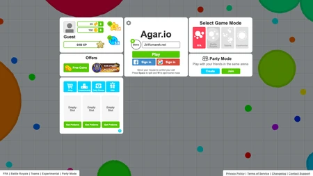
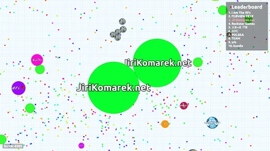
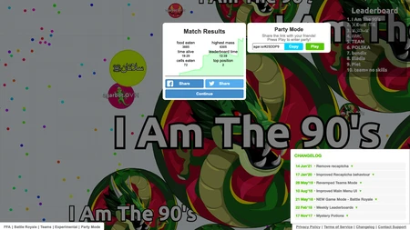
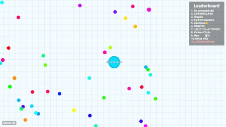
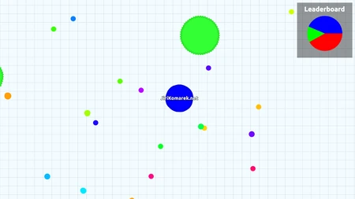
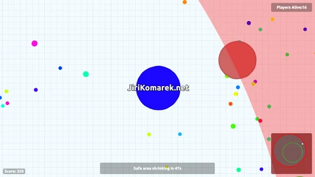
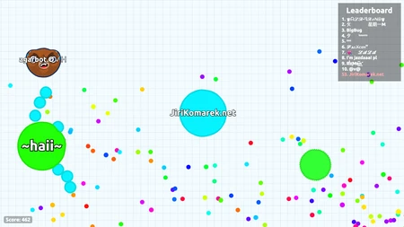
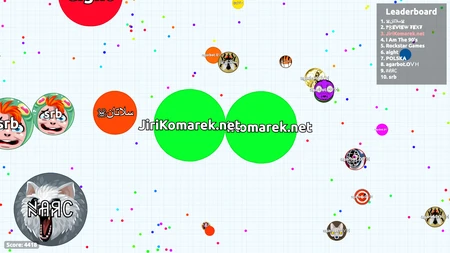
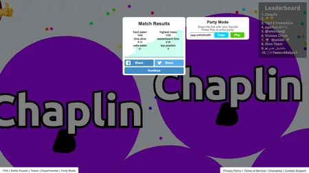

[Agar.io](https://agar.io/) (často psáno také agario) je webová hra, ve které jezdíte se svou buňkou po hrací ploše, požíráte agar a menší soupeře a snažíte se vyhnout virům a větším soupeřům. Hru vytvořil brazilský vývojář Matheus Valadares a spustil ji 28. dubna 2015. Vydává ji společnost Miniclip a kromě prohlížeče je dostupná i jako mobilní aplikace pro iOS a Android. Ani po více než deseti letech hra nezanikla a tento návod popisuje, jak Agar.io hrát, jak funguje ovládání, skiny a herní módy.

## Herní princip
Hráč myší ovládá malou buňku, která roste tím, jak kolem sebe sbírá agar (malé barevné kuličky) či jiné buňky. V pravém horním rohu je vždy statistika s top 10 hráči dané hry. Cílem ostatních je získat větší a větší podíl a dostat se na úkor ostatních na co nejvyšší pozici. S tím, jak buňka roste, se však zároveň zpomaluje, ovšem zvětšuje se oblast, kterou ze své pozice vidí.

Pokud najede znatelně větší buňka na menší, pozře ji a tím se zvětší. Ovšem najede-li od určité velikosti na bacil (zelená zubatá kolečka), ten buňku rozstřelí na malé dílky do celého okolí. Tím hráč sice získá rychlost, ale je snadnou kořistí pro další hráče.

<article class="article col col-12 col-t-12">
<ul class="image-gallery">

<li></li>
<li></li>
<li></li>

</ul>
</article>

## Herní módy
Agar.io disponuje několika herními módy.
### FFA (všichni proti všem)
FFA je klasický mód, ve kterém hrajete sami za sebe proti ostatním hráčům z internetu. Cílem je co nejvíc vyrůst, dostat se do žebříčku top 10 a vydržet tam co nejdéle.
### Battle Royale
Battle Royale je podobný FFA, ale všichni hráči začínají současně a hrací plocha se po určité době zmenšuje, takže se k sobě soupeři musí přibližovat. Vyhrává ten, kdo přežije do konce.

### Týmová hra
V týmovém módu je v pravém horním rohu místo top 10 hráčů koláčový graf, jenž ukazuje, který ze tří týmů (rudí, zelení a modří) drží kolik procent. Strategie hry se tím také mění: nyní není nejdůležitější přežití a růst jedince, ale celého týmu.

### Experimental
Po některých novinkách, které se u většiny hráčů nesetkaly se souhlasem, byla založena nová větev Experimental, kde se zkoušejí věci, které se v případě úspěchu přesunou do hlavní větve. Novinkou, která byla přidána 11. 6. 2015, je buňka Matka: těch je několik, nacházejí se různě po hracím poli a střílí okolo sebe 10 % veškerého agaru, který se ve hře objeví. Najedete-li na tuto buňku, ta vás pohltí a okamžitě do okolí vystřelí množství agaru podle velikosti buňky, která do ní najela.

Ve větvi experimental také fungují jinak bacily: pokud do nich hráč střílí svoji hmotu, bacil nijak neroste, pouze vystřelí nový bacil opačným směrem, než do něj krmíte.

### Párty
Mód párty se nijak neliší od klasické hry všichni proti všem, jediný rozdíl je v tom, že tyto hry jsou soukromé a hrajete v nich pouze proti přátelům, které jste si sami pozvali.

<article class="article col col-12 col-t-12">
<ul class="image-gallery">

<li></li>
<li></li>
<li></li>

</ul>
</article>

## Ovládání Agar.io
* **Myš:** pohyb buňky
* **Mezerník:** rozdělení buňky
* **W:** vystřelení hmoty
* **Kolečko myši:** přiblížení a oddálení
* **Esc:** opuštění pozorovacího módu

Na úvodní stránce hráč zvolí přezdívku, vybere herní mód, případně si v nastavení zvolí některou z možností (či klikne na "Spectate", čímž se dostane do pozorovacího módu, ve kterém může sledovat život té nejúspěšnější buňky. Z něj se dostane pomocí stisku klávesy "Esc") a kliknutím na "Play" začne hrát.

Buňka se ovládá pomocí pohybů myši v omezeném čtvercovém poli, kdy směr buňky v 2D prostoru je dán polohou myši. Zajedete-li tedy myší doleva, pojede tímto směrem i vaše buňka. Na mobilu a tabletu si Agar.io zahrajete v oficiální aplikaci pro iOS a Android, kde se buňka ovládá dotykem.

Pomocí mezerníku lze vaši buňku rozdělit (je-li dostatečně velká). To je výhodné ve dvou situacích: jste-li pronásledován větší buňkou, od které hrozí pozření, můžete se rozdělit a tak uniknout (malé buňky jsou rychlejší než ty velké), případně si takto necháte sežrat pouze část své buňky. Daleko častěji se však dobrovolně rozdělují buňky v situacích, kdy jsou již dostatečně velké a kolem nich se pohybuje jedna či více malých buněk. Rozdělením se polovina buňky "odpálí" ve směru pohybu a je-li dostatečně velká, tak pozře vše co je v cílové destinaci. K opětovnému sloučení dochází po určitém čase, což lze vypozorovat tak, že při dotyku se buňky do sebe jakoby vlévají.

Poslední možností je klávesa "W". Pomocí ní hráč střílí část své buňky do prostoru. To opět plní dvě základní funkce. Buďto tímto "krmíte" někoho dalšího, což je zvlášť výhodné v týmovém módu, neboť je to jedna z cest k získání dominantního postavení týmu. Účinnost je však jen 80 %, tj. přijímající hráč získá pouze 80 % hmoty, kterou vystřelíte, zbytek zmizí. V single-player módu může sloužit k tomu samému účelu, ovšem spíše se využívá k šíření bacilů. Je-li totiž jeden z bacilů dostatečně nakrmen (sedmkrát), vystřelí nový bacil opačným směrem, než do něj krmíte. Tímto způsobem je možné krmit bacil v blízkosti opravdu velké buňky, vystřelit z něj nového bacila na obrovskou buňku, ta se tímto rozprskne na spoustu malých a ty lze poté jednoduše sesbírat.

<article class="article col col-12 col-t-12">
<ul class="image-gallery">

<li></li>
<li></li>
<li></li>

</ul>
</article>

## Tipy a triky
Jste-li menší a chcete-li se dostat mezi dvěma zhruba stejně velkými nepřátelskými buňkami, nebojte se mezi nimi proplout. Žádná z nich totiž na vás nevystřelí, protože by se tím stala pro druhou snadnou kořistí. To platí i pro týmovou hru, jste-li v blízkosti své vlastní velké buňky nebo mezi dvěma jinými barvami. Proklouznout se dá i mezi buňkami stejné barvy či dokonce mezi dvěma částmi rozdělené buňky, ale manévrovací prostor je tam extrémně malý a riziko pozření velké, tudíž je to strategie vhodná pouze v nejvyšší nouzi.

Hrajete-li týmovou hru a je-li váš parťák v nebezpečí, krmte jej, aby přerostl soupeřovu buňku (máte-li na to kapacity). Další vítanou pomocí je "rozstřelení" soupeřovy buňky při průjezdu kolem bacilu. Pokud vám někdo pomůže v těchto situacích či při skupinovém lovu, bývá slušností se mu za pomoc odvděčit přiměřeným množstvím hmoty pomocí tlačítka "W". Tím se nadále posiluje vědomí kolektivu a roste spolupráce, což je výhodné jak pro tým, tak i pro jednotlivce, neboť sám nemá v prostředí ovládaném jinou barvou žádnou šanci na přežití.

## Skiny v Agar.io
Skiny mění vzhled vaší buňky. Po kliknutí na tlačítko **Skins** vedle přezdívky se otevře obchod se skiny. Většina skinů se kupuje za mince a jsou rozdělené do kategorií, například Premium nebo Veteran. Vlastní vzhled buňky si můžete navrhnout v editoru *Create your own skin*. V počátcích hry se skiny získávaly zadáním speciální přezdívky (třeba názvu státu), dnes je hlavní cestou právě menu Skins.

## Statistika
V červenci 2015 byla do hry přidána statistika. Ta se zobrazí vždy, když zemřete, a lze na ní vidět, jak jste rostli, kolik jste sežrali cizích buněk, kdy jste byli ve vedení a podobně.

Nechcete-li se zabývat těmito podružnostmi, stačí, když si volbu ukazování statistiky vypnete v nastavení.

## Účty, úrovně a odměny
Hrát můžete jako host bez registrace, nebo se přihlásit přes Facebook či Google. Hráči získávají zkušenosti (XP) a úrovně a sbírají dvě měny, mince a DNA, za které se nakupuje v obchodě (Shop). Lektvary (potions), denní úkoly a dárky přinášejí další odměny, například mince, skiny a dočasné zvýšení hmoty.

## Agar.io v roce 2026
Hru stále vyvíjí společnost Miniclip. Verze v prohlížeči nabízí módy FFA, Battle Royale, Teams, Experimental a Party popsané výše a mobilní aplikace dostává pravidelné aktualizace. Podle stránky aplikace na Google Play začala 1. května 2026 nová sezóna se sbíráním žetonů, odměnami a volitelnou placenou propustkou.

**[Article in English](/web/how-to-play-agar-io-skins-controls-description/)**

<b><a href="../">Přehled technických článků</a></b>

